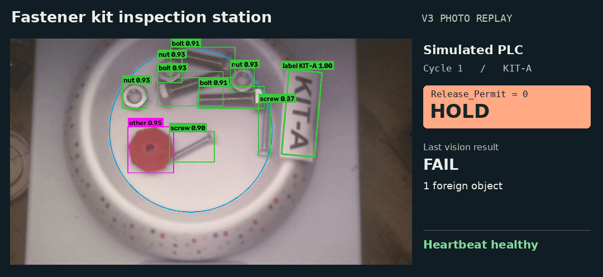

# Fastener Kit Inspection Station

A fixed-camera inspection station for fastener kits. It counts the bolts, nuts and screws on a tray, spots foreign objects, reads the kit label, decides **PASS / FAIL / REVIEW**, and hands the result to a **simulated** Allen-Bradley PLC. The PLC releases the kit only on a PASS for the current cycle; anything else, including silence, holds it.

[](https://neddia.github.io/kit-inspect/)

**[Explore recorded inspections](https://neddia.github.io/kit-inspect/)** · [How the PLC handshake works](#how-it-works) · [Evaluation results](#inspection-results)

Cycle 10 shows why counting parts alone is insufficient. The PLC ordered KIT-B, but the camera read KIT-A on the tray. Open the viewer to see the frame and the station’s recorded reason for failing that kit. The animation above replays saved photos through the vision station and PLC simulator, then stops vision so you can see the watchdog withdraw release permission.

## Inspection results

**Final test**: 48 trays photographed under normal conditions (kit tag in view, parts dropped in by hand), shot blind and scored once with the frozen model and settings:

| | Trays | PASS | REVIEW | FAIL |
| --- | --- | --- | --- | --- |
| Faulty kits (missing, extra or wrong parts, foreign objects) | 24 | **0** | 1 | 23 |
| Good kits | 24 | 18 | 5 | 1 |

No faulty kit was released. One good kit failed because a screw lay almost entirely under a bolt; five went to an operator, mostly nuts tucked against other parts. Median 120 ms per tray. [Per-tray results](reports/stage6/v3_test01/per_image.csv) · [Every experiment and model comparison](experiments.md)

On a harder 20-tray challenge set used for model selection (odd poses, stacked parts, junk never seen in training), the station also passed 0 of 14 faulty kits.

## Run the demo

To explore the 16 cycles from the recorded bench run in a fresh clone, run `python3 -m http.server 8000 --bind 127.0.0.1 --directory docs` and open <http://localhost:8000>. This uses only Python’s standard library.

To browse the latest 100 records on a station with local history, run `uv run kit dashboard` and open <http://localhost:8010>. Refresh to load new cycles. The station saves a photo, vision verdict and timing under each history ID. Its SQLite rows do not store the PLC release tag.

For the two-window operator demo, install the project dependencies and supply the configured station model from your training/export run. Model weights and the full photo sessions are excluded from Git.

```bash
uv sync                          # once (training PC). Station laptop: uv sync --no-default-groups --group prod
uv run kit demo                  # PLC operator panel + vision station, as two separate apps
```

In the **PLC panel**: `1` / `2` picks the kit the line is building, `SPACE` sends a kit, `a` sends one every 4 s.
The big lamp is the PLC's real `Release_Permit` tag. The **station window** shows the camera, what it found and why.

Things to try:
- A correct kit → **RELEASE**. Take a nut out → **HOLD**, "missing 1 nut".
- Put the KIT-A label on a KIT-B order → **HOLD**, "label says KIT-A, PLC expects KIT-B".
- Close the station window while the lamp says RELEASE → the PLC sees the heartbeat stop and drops to **HOLD** by itself.
- Unplug the camera → the station raises a fault at once; plug it back in and it recovers.

No camera? `uv run kit demo --images data/images/hardval2` replays photos instead.

## How it works

```
  PLC operator panel (simulated PLC)                 Vision station
  ──────────────────────────────────                 ──────────────
  kit code, cycle id, trigger        ───────────>    fresh photo after the trigger
                                                     detector (YOLO26n: bolt, nut, screw, other)
                                                     scene check (tray found, position, light)
                                                     unknown-object check (OpenCV)
                                                     kit label check (OCR)
                                                     rules -> PASS / FAIL / REVIEW + reasons
  release only on a matched PASS     <───────────    result + cycle id, done
  watchdog: heartbeat lost -> HOLD   <───────────    heartbeat every 500 ms, fault flag
```

The model reports what it sees; plain code decides (`src/inspection/decision.py`). Every inspection is kept (photo + database row) in `data/history/`.

## Improve the model

| Step | Command | What it does |
| --- | --- | --- |
| Set up | `uv run kit camera` | Live view and locked camera settings |
| Photograph | `uv run kit capture` | Guided sessions from `configs/capture_plan.yaml`; records the truth for every photo |
| Recover real failures | `uv run kit harvest` | Pull the exact station frame that fooled it (by history `#id`) into a session |
| Label | `uv run kit label` | SAM 3 outlines every new photo, then a review tool to fix them by eye |
| Train | `uv run kit train NAME` | A named **candidate** model (PyTorch + OpenVINO). The station keeps its current model |
| Evaluate | `uv run kit eval --model ...` | PASS / FAIL / REVIEW scored against the recorded truth |

A candidate becomes the station's model only when you set `inspection.model` in `configs/station.yaml`. Every experiment and decision is logged in `experiments.md`.

## Repo layout

| Folder | What's in it |
| --- | --- |
| `configs/` | Kit specs, station settings, capture plan |
| `data/` | `manifest.csv` (one row per photo, with the truth), labels; photos and history not in Git |
| `src/capture` | Camera, guided capture |
| `src/labeling` | SAM 3 auto-labelling, review tool, YOLO export |
| `src/train` | Training |
| `src/inspection` | Detector pipeline, scene check, unknown-object check, kit label OCR, decision rules |
| `src/plc` | Simulated PLC, its operator panel, tag map |
| `src/station` | The vision station, camera feed, PLC handshake, history |
| `src/eval` | Scoring, plus the earlier experiments (zero-shot baseline, PatchCore) |
| `tests/` | Decision rules, PLC handshake and fail-safes, label check, unknown-object check |

## Known limits

- The kit tag sits on the bowl's rim, and the model has learned to ignore it. Junk lying **on** the tag is barely seen: in a 6-tray check it was held only because it hid the printed letters. The fix is physical: a flat tag outside the bowl.
- 0 of 24 is a small sample: the true false-pass rate could still be a few percent. Laptop timing is pending.
- The PLC is simulated (cpppo + pylogix). No real controller was used.
- Junk the model has never seen relies on the OpenCV check, which can't see objects inside a part's box.

## License note
Ultralytics YOLO models are AGPL-3.0 licensed.
