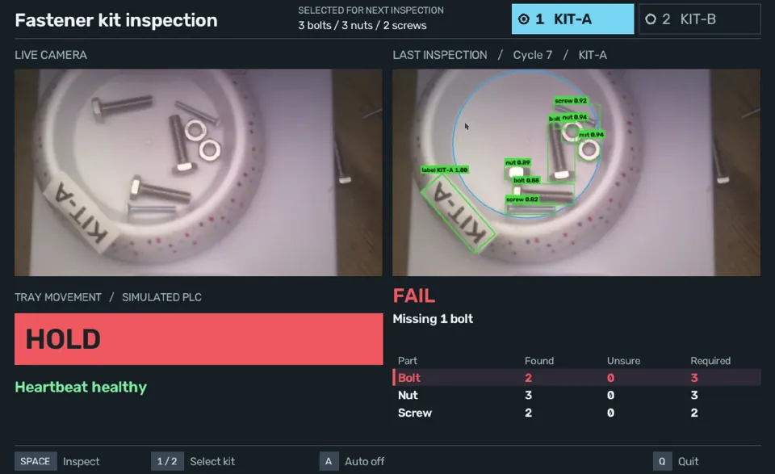
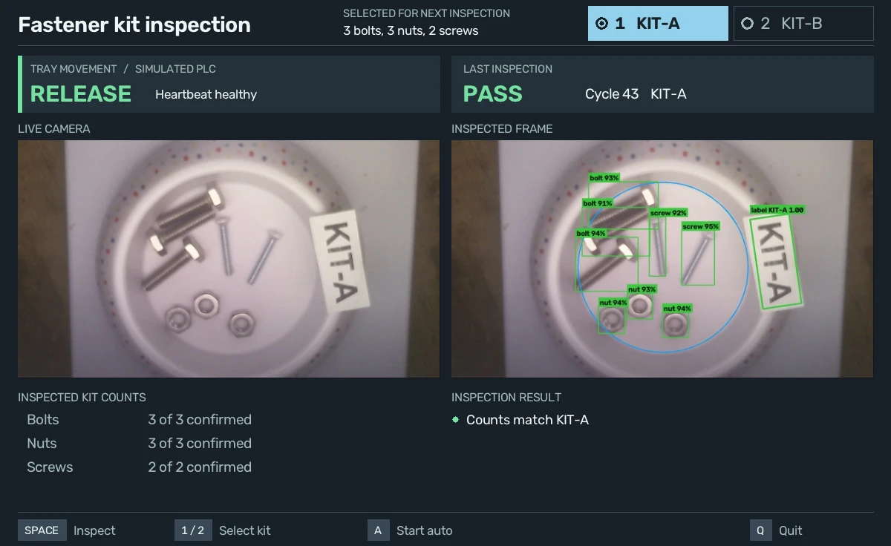
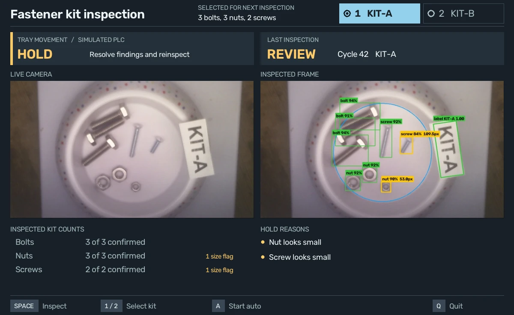

# Fastener Kit Inspection Station

A machine vision station that decides whether a fastener kit may leave the station. A fixed camera counts the bolts, nuts and screws, checks that each nut and screw is the right size, catches foreign objects and reads the printed kit tag. A simulated Allen-Bradley PLC releases the tray only on a PASS that answers its own request; anything else, including a silent camera, holds it.

**[Watch the station demo (1:21) and explore eight inspections](https://neddia.github.io/kit-inspect/)** · [How it works](#how-it-works) · [Every experiment and decision](experiments.md)

[](https://neddia.github.io/kit-inspect/)

## Results

**Blind test**: 48 KIT-A trays photographed under normal conditions (kit tag in view, parts dropped in by hand), shot blind and scored once with the model and settings frozen:

| | Trays | PASS | REVIEW | FAIL |
| --- | --- | --- | --- | --- |
| Faulty kits (missing, extra or wrong parts, foreign objects) | 24 | **0** | 1 | 23 |
| Good kits | 24 | 18 | 5 | 1 |

No faulty kit was released, including foreign objects never seen in training. Five good kits went to an operator, mostly a nut tucked against another part; one was failed wrongly because a screw lay almost entirely under a bolt ([it's tray 4 in the demo](https://neddia.github.io/kit-inspect/#inspection-3)). Median 120 ms per tray on a CPU. [Per-tray results](reports/eval/v3_test01/per_image.csv)

On a harder 20-tray challenge set used for model selection (odd poses, stacked parts, junk never seen in training), the station also released 0 of 14 faulty kits.

### Part-size check (added after the blind test)

Counting alone can't tell a short screw from the right one. The station now measures every nut and screw against per-kit limits and holds the tray when one is out of range.

| Normal kit | Same layout, small nut and short screw swapped in |
| --- | --- |
| [](docs/size-check-pass.webp) | [](docs/size-check-review.webp) |

| | Wrong-size parts released |
| --- | --- |
| Count-only decision, [24 paired trays](reports/eval/v3_size_pairs01_baseline/summary.txt) (regular part, then the same spot with a smaller one) | 8 of 12 |
| With the size check, [same trays plus 6 short-screw trays](reports/eval/size_check_swaps/summary.txt) | **0 of 18** (16 REVIEW, 2 FAIL) |

The limits come from isolated regular parts in the training photos: a nut's longest box side, a screw's box diagonal. Re-scoring the blind test with the check on gives the same table as above. These swap sets are not blind (they were used to check the limits), and the short screw is only 10-15% shorter than a regular one: short screws measured 142-158 px against a 160 px minimum, and the shortest regular screw lying in the clear measured 163 px.

## What's in it

| Area | What was built |
| --- | --- |
| Vision pipeline | YOLO26n detection (bolt, nut, screw, foreign object), an OpenCV check for objects the model has never seen, OCR of the kit tag, a part-size check, and plain-code decision rules. OpenVINO on CPU |
| Model lifecycle | Guided photo capture that records the truth for every photo, SAM 3-assisted labelling with a review tool, training, PASS / FAIL / REVIEW scoring against the truth, and retraining on misses pulled from the station's own history |
| PLC integration | Logix tag map over EtherNet/IP (pylogix client, cpppo simulator), cycle-ID handshake, heartbeat watchdog, fault flag, automatic reconnect |
| Error-proofing | Release only on a PASS for the current request. A wrong kit tag is a hold even when every part is there, and so is a nut or screw of the wrong size. A lost camera raises a fault and holds |
| Traceability | Every inspection stored with its photo, verdict, reasons and timings, with a viewer for the history |
| Operator screens | PLC panel (kit select, RELEASE / HOLD lamp, heartbeat and fault lamps) and a station window with the verdict banner |

## Run the demo

To explore the eight selected v3 replay cycles in a fresh clone, run `python3 -m http.server 8000 --bind 127.0.0.1 --directory docs` and open <http://localhost:8000>. This uses only Python’s standard library.

To browse the latest 100 records on a station with local history, run `uv run kit dashboard` and open <http://localhost:8010>. Refresh to load new cycles. The station saves a photo, vision verdict and timing under each history ID. Its SQLite rows do not store the PLC release tag.

For the single-window operator demo, install the project dependencies and supply the configured station model from your training/export run. Model weights and the full photo sessions are excluded from Git.

```bash
uv sync                          # once (training PC). Station laptop: uv sync --no-default-groups --group prod
uv run kit demo                  # one recording window for the station and simulated PLC
```

In the **PLC panel**: `1` / `2` picks the kit the line is building, `SPACE` sends a kit, `a` sends one every 4 s.
The lamp reads the simulated PLC’s `Release_Permit` signal. When it is on, this tray may move to the next station. When it is off, the tray must stay put. The two images are the same size. The left shows the current tray and PLC state. The right shows the last inspection with its verdict, reason and part counts.

Things to try:
- A correct kit → **RELEASE**. Take a nut out → **HOLD**, "missing 1 nut".
- Put the KIT-A label on a KIT-B order → **HOLD**, "label says KIT-A, PLC expects KIT-B".
- Swap in a shorter screw or a smaller nut → **HOLD**, "Screw looks small".
- Press `q` or close the operator window to end the demo. To run the components independently, use `kit plc` and `kit station --show`.
- Unplug the webcam while the panel shows RELEASE. The PLC switches to HOLD. Plug it back in and wait for the live picture to return, then send a correct kit to see RELEASE again. On WSL the station uses Windows’ `usbipd.exe` to reattach the already-shared C510 automatically.

No camera? `uv run kit demo --images data/images/hardval2` replays photos instead.

## How it works

```
  PLC operator panel (simulated PLC)                 Vision station
  ──────────────────────────────────                 ──────────────
  kit code, cycle id, trigger        ───────────>    fresh photo after the trigger
                                                     detector (YOLO26n: bolt, nut, screw, other)
                                                     scene check (tray found, position, light)
                                                     unknown-object check (OpenCV)
                                                     kit label check (OCR)
                                                     part-size check (nut side, screw length)
                                                     rules -> PASS / FAIL / REVIEW + reasons
  release only on a matched PASS     <───────────    result + cycle id, done
  watchdog: heartbeat lost -> HOLD   <───────────    heartbeat every 500 ms, fault flag
```

The model reports what it sees; plain code decides (`src/inspection/decision.py`). Every inspection is kept (photo + database row) in `data/history/`.

## Improve the model

| Step | Command | What it does |
| --- | --- | --- |
| Set up | `uv run kit camera` | Live view and locked camera settings |
| Photograph | `uv run kit capture` | Guided sessions from `configs/capture_plan.yaml`; records the truth for every photo |
| Recover real failures | `uv run kit harvest` | Pull the exact station frame that fooled it (by history `#id`) into a session |
| Label | `uv run kit label` | SAM 3 outlines every new photo, then a review tool to fix them by eye |
| Train | `uv run kit train NAME` | A named **candidate** model (PyTorch + OpenVINO). The station keeps its current model |
| Evaluate | `uv run kit eval --model ...` | PASS / FAIL / REVIEW scored against the recorded truth |

A candidate becomes the station's model only when you set `inspection.model` in `configs/station.yaml`. Every experiment and decision is logged in `experiments.md`.

## Repo layout

| Folder | What's in it |
| --- | --- |
| `configs/` | Kit specs, station settings, capture plan |
| `data/` | `manifest.csv` (one row per photo, with the truth), labels; photos and history not in Git |
| `src/capture` | Camera, guided capture |
| `src/labeling` | SAM 3 auto-labelling, review tool, YOLO export |
| `src/train` | Training |
| `src/inspection` | Detector pipeline, scene check, unknown-object check, kit label OCR, decision rules |
| `src/plc` | Simulated PLC, its operator panel, tag map |
| `src/station` | The vision station, camera feed, PLC handshake, history |
| `src/eval` | Scoring, plus the earlier experiments (zero-shot baseline, PatchCore) |
| `tests/` | Decision rules, PLC handshake and fail-safes, label check, unknown-object check |

## Known limits

- The kit tag sits on the bowl's rim, and the model has learned to ignore it. In the [six-tray tag challenge](reports/eval/v3_labelval/per_image.csv), two objects touching the tag produced FAIL. All four objects covering its lettering produced REVIEW with an unreadable tag. Debris on a blank margin could escape that check. The fix is physical: a flat tag outside the bowl.
- 0 of 24 is a small sample: the true false-pass rate could still be a few percent. Laptop timing is pending.
- The PLC is simulated (cpppo + pylogix). No real controller was used.
- Junk the model has never seen relies on the OpenCV check, which can't see objects inside a part's box.
- The size check measures the detector's box, not the part. A partly hidden part reads small and two touching nuts boxed as one read large; both go to REVIEW, never PASS. Merged nut boxes measured 96-125 px against at most 93 px for a single nut. The limits are in pixels, so they hold only while the camera height and zoom stay fixed. The demo's 91 px nut maximum is set to catch a slightly oversized nut and is close to real nuts; about 94 px would catch merged nuts and leave single nuts alone.

## On a real line, next

- **Lighting and fixturing first.** Diffuse light and a flat tag holder outside the bowl would remove most of the false holds (part shadows, the tag sitting on the rim) and close the tag gap above. A tray with one pocket per part would stop parts stacking, the main source of merged and hidden detections.
- **Measure the part, not the box.** Find the nut's outline or the screw's ends inside each box, with a calibrated camera, so size limits can be in millimetres and tighter.
- **A second camera** at an angle for parts hidden under other parts, the cause of the one wrong FAIL.
- **A real controller.** The tag map stays the same; the simulator is replaced by a CompactLogix or ControlLogix, or the station talks through Kepware / OPC UA.
- **Deployment and monitoring.** Run the station in a container on the line PC, alert on faults, heartbeat loss and a rising review rate, and keep harvesting real misses into the next training round.

## How this was built

Developed with an AI coding assistant (Claude Code, credited as co-author on the commits). The camera rig, the photos, the label review and the go / no-go decisions are the author's. Every decision and the evidence behind it is logged in [experiments.md](experiments.md).

## License note
Ultralytics YOLO models are AGPL-3.0 licensed.
